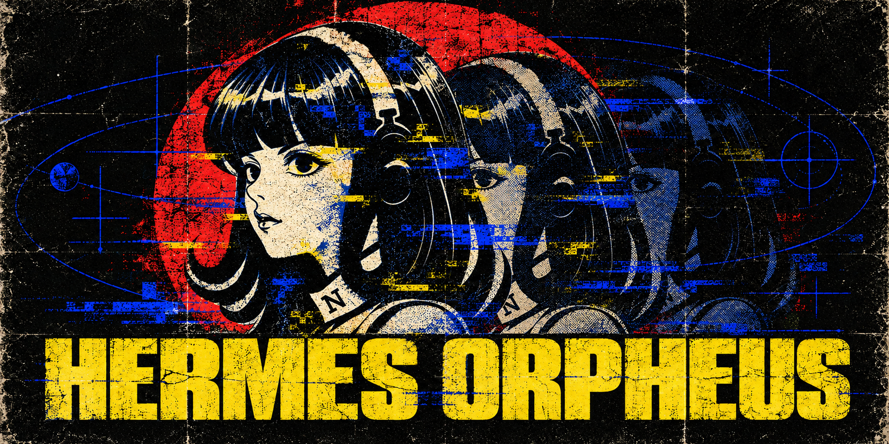

<p align="center">
  
</p>

# Hermes Orpheus

**Give Hermes reusable specialists for the task at hand.** Define execution presets once, then use them to launch native subagents or start sessions from webhooks—without modifying Hermes core.

[Get started](#get-started) · [Write a configuration](docs/configuration-guide.md) · [Examples](examples/) · [How it works](docs/implementation.md)

## What you get

- **Reusable presets.** Group a role's instructions, model choices, and toolsets in one configuration.
- **Controlled selection.** Let a parent agent choose, use deterministic rules, or route finite choices through the System One API, including Jev through OpenRouter.
- **Two entrypoints.** Delegate work inside a conversation, or select a preset before creating a fresh webhook session.
- **Trackable runs.** Discover presets, launch children, retrieve results, and request cancellation. Duplicate webhook bodies reuse their original request.

| | Native subagent | Webhook session |
| --- | --- | --- |
| Who chooses | Fixed configuration, parent agent, rules, or System One | Fixed configuration, rules, or System One |
| Model | From operator-authorized choices | From target-authorized choices |
| Effort | Inherits Hermes settings; explicit overrides are rejected | May be selected when the target supports it |

Presets describe allowed choices; deployment settings authorize where they can run. Selections must resolve to one allowed combination before launch.

## Get started

1. **Install** using the [Hermes directory-plugin instructions](docs/installation.md#install-the-plugin).
2. **Configure** your models and presets with the [configuration authoring guide](docs/configuration-guide.md). You can give that guide to your agent to prepare the YAML for you.
3. **Enable and verify** the plugin, then start a new Hermes session with the `orpheus` toolset available:

   ```sh
   hermes plugins enable hermes-orpheus
   hermes plugins doctor hermes-orpheus --ci
   ```

To have an agent prepare the configuration, give it this request:

> Read `docs/configuration-guide.md` and prepare preset and deployment YAML for my use case. Validate the files and report any settings that still require operator verification.

The [starter preset](examples/presets.yaml) offers an `analyst` role with two model choices. Its model names are placeholders, and the [deployment example](examples/deployment.yaml) deliberately blocks execution until you verify and authorize your real provider/model pairs.

After configuring a compatible preset, ask Hermes:

> Discover the available Orpheus presets, choose one suited to this task, and delegate the work. Return the child's result when it finishes.

The native tool flow is `orpheus_presets` → `orpheus_spawn` → `orpheus_status`. Use `orpheus_cancel` to request cancellation.

## Configuration paths

| Start here | Use it for |
| --- | --- |
| [Agent-ready configuration guide](docs/configuration-guide.md) | Write and validate presets and deployment settings |
| [Native subagent example](examples/presets.yaml) | Let the parent choose a preset and model |
| [System One example](examples/systemone-presets.yaml) | Let System One select a compatible model tuple |
| [Webhook examples](examples/webhook-presets.yaml) | Bind routes to preset selection policies |
| [Installation and operation](docs/installation.md) | Plugin setup, endpoint configuration, and runtime details |

Secrets stay outside preset files and Git. Configuration references credential environment variable names, never their values. Native subagents do not support per-child effort or maximum-turn overrides in this release. See [implementation limits](docs/implementation.md) before enabling a deployment.

## Development

Python 3.11+ and [uv](https://docs.astral.sh/uv/) are required for local development.

```sh
uv sync
uv run orpheus validate examples/presets.yaml --deployment examples/deployment.yaml
uv run orpheus inspect examples/presets.yaml
uv run pytest -q
uv build
```

The `orpheus` console command and `python -m orpheus.cli` invoke the same CLI. `validate` checks configuration structure; `inspect` expands model references. Neither sends a model request or proves provider connectivity.

[Design](docs/design.md) · [Requirements](docs/spec/subagent-presets.md) · [Review records](docs/reviews/README.md) · [Local Hermes test](docs/evidence/local-hermes/README.md)
